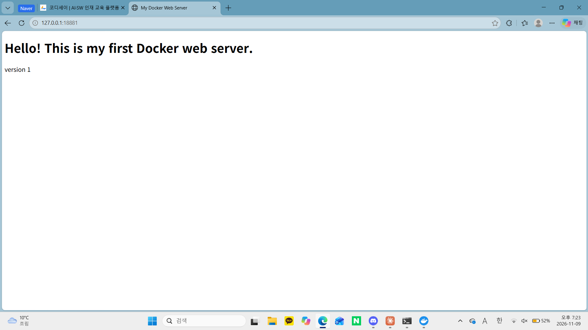
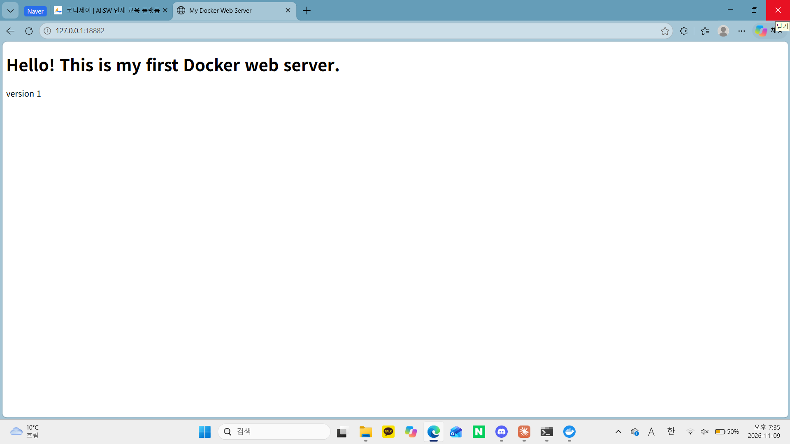
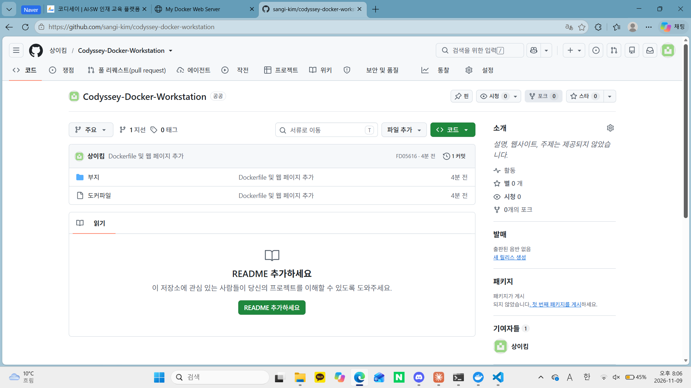
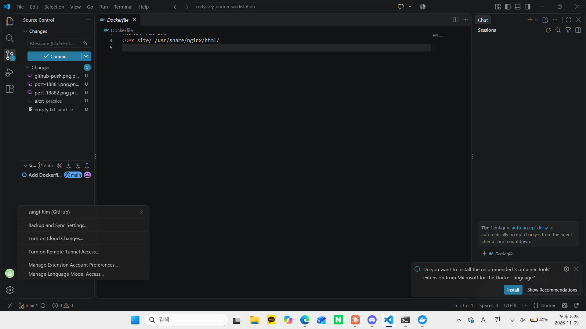

# Docker 개발 워크스테이션 구축

## 1) 프로젝트 개요

터미널로 작업 디렉토리와 권한을 정리하고, Docker를 설치·점검한 뒤 컨테이너를 실행·관리한다. 이어서 NGINX 기반 웹 서버를 Dockerfile로 컨테이너화하고, 포트 매핑으로 접속을 확인하며, 바인드 마운트와 볼륨으로 "변경 반영"과 "데이터 영속성"을 직접 검증한다. 마지막으로 Git/GitHub/VSCode를 연동해 결과를 저장소로 제출한다.

### 학습 목표 점검
- [x] 절대 경로와 상대 경로의 차이를 예시와 함께 설명한다. → [13) 개념 정리](#13-개념-정리)
- [x] 파일 권한 r/w/x와 755, 644 표기의 해석 규칙을 설명한다. → [6) 권한 실습](#6-권한-실습), [13) 개념 정리](#13-개념-정리)
- [x] 기존 Dockerfile을 기반으로 커스텀 이미지를 만든다. → [8) 커스텀 이미지](#8-커스텀-이미지-dockerfile)
- [x] 포트 매핑이 필요한 이유를 설명한다. → [9) 포트 매핑](#9-포트-매핑-접속-증거-2회), [13) 개념 정리](#13-개념-정리)
- [x] Docker 볼륨(영속 데이터)을 설명한다. → [11) 볼륨 영속성](#11-docker-볼륨-영속성)
- [x] Git과 GitHub의 역할 차이를 설명한다. → [13) 개념 정리](#13-개념-정리)

## 2) 실행 환경

| 항목 | 값 |
|---|---|
| OS | Windows (빌드 26100) |
| Shell / 터미널 | Windows PowerShell 5.1 (VSCode 내장 터미널 병행) |
| Docker | 29.9.2 (build a82e528), Docker Desktop, WSL2 백엔드 |
| Git | 2.56.0.windows.4 |
| 권한 실습 환경 | Docker `ubuntu` 컨테이너 (리눅스 `chmod`/`ls -l` 사용) |

```powershell
PS C:\Users\mn030> $PSVersionTable.PSVersion

Major  Minor  Build  Revision
-----  -----  -----  --------
5      1      26100  9444

PS C:\Users\mn030> git --version
git version 2.56.0.windows.4
PS C:\Users\mn030> docker --version
Docker version 29.9.2, build a82e528
```

## 3) 수행 체크리스트

- [x] 터미널 기본 조작 (위치/목록/이동/생성/복사/이름변경/삭제/내용 확인) → [5)](#5-터미널-조작-로그-powershell)
- [x] 권한 변경 실습 (파일 1개 + 디렉토리 1개, 전/후 비교) → [6)](#6-권한-실습)
- [x] Docker 설치/점검 (`docker --version`, `docker info`) → [7-1)](#7-1-설치-점검)
- [x] hello-world 실행 → [7-2)](#7-2-hello-world-실행)
- [x] ubuntu 컨테이너 진입 + 간단 명령 → [6)](#6-권한-실습)
- [x] Docker 기본 운영 (`images`, `ps`, `ps -a`, `logs`, `stats`) → [7-3)](#7-3-컨테이너-운영-명령)
- [x] attach/exec 차이 관찰 → [7-3)](#7-3-컨테이너-운영-명령)
- [x] Dockerfile 커스텀 이미지 빌드/실행 → [8)](#8-커스텀-이미지-dockerfile)
- [x] 포트 매핑 접속 (2회) → [9)](#9-포트-매핑-접속-증거-2회)
- [x] 바인드 마운트 반영 (전/후 비교) → [10)](#10-바인드-마운트)
- [x] Docker 볼륨 영속성 (컨테이너 삭제 전/후) → [11)](#11-docker-볼륨-영속성)
- [x] Git 설정 (`git config --list`) → [12)](#12-git--github--vscode)
- [x] GitHub 저장소 연동 + push → [12)](#12-git--github--vscode)
- [x] VSCode GitHub 로그인 + 저장소 폴더 연동 → [12)](#12-git--github--vscode)

## 4) 디렉토리 구성과 검증 방법

```
codyssey-docker-workstation/
├── README.md        # 기술 문서 (이 파일)
├── Dockerfile       # nginx:alpine 기반 커스텀 이미지 정의
├── site/            # 웹 서버 정적 콘텐츠 (index.html)
├── practice/        # 터미널 조작 실습용 폴더 (a.txt, empty.txt)
└── evidence/        # 브라우저/GitHub/VSCode 스크린샷
```

| 검증 대상 | 사용한 명령 | 확인한 것 | 증거 위치 |
|---|---|---|---|
| 터미널 조작 | `Get-Location`, `New-Item`, `Copy-Item`, `Move-Item`, `Remove-Item` 등 | 생성/복사/이름변경/삭제 동작 | [5)](#5-터미널-조작-로그-powershell) |
| 권한 변경 | `ls -l`, `chmod 600/755/700` | 변경 전/후 권한 문자열 | [6)](#6-권한-실습) |
| Docker 동작 | `docker --version`, `docker info` | 클라이언트/데몬 정상 | [7-1)](#7-1-설치-점검) |
| 컨테이너 실행 | `docker run hello-world` | `Hello from Docker!` | [7-2)](#7-2-hello-world-실행) |
| 포트 매핑 | `docker run -p`, `curl.exe`, 브라우저 | 호스트 포트로 페이지 응답 | [9)](#9-포트-매핑-접속-증거-2회) |
| 바인드 마운트 | `docker run -v`, 호스트 파일 수정 | 수정 즉시 반영 | [10)](#10-바인드-마운트) |
| 볼륨 영속성 | `docker volume create`, `docker rm -f` | 컨테이너 삭제 후 데이터 유지 | [11)](#11-docker-볼륨-영속성) |
| Git/GitHub | `git config --list`, `git remote -v`, `git push` | 설정과 원격 업로드 | [12)](#12-git--github--vscode) |

## 5) 터미널 조작 로그 (PowerShell)

```powershell
PS C:\Users\mn030> Get-Location

Path
----
C:\Users\mn030


PS C:\Users\mn030> cd $HOME
PS C:\Users\mn030> mkdir codyssey-docker-workstation


    디렉터리: C:\Users\mn030


Mode                 LastWriteTime         Length Name
----                 -------------         ------ ----
d-----      2026-11-09   오후 6:06                codyssey-docker-workstation


PS C:\Users\mn030> cd codyssey-docker-workstation
PS C:\Users\mn030\codyssey-docker-workstation> Get-Location

Path
----
C:\Users\mn030\codyssey-docker-workstation


PS C:\Users\mn030\codyssey-docker-workstation> Get-ChildItem -Force
(출력 없음: 빈 폴더)
PS C:\Users\mn030\codyssey-docker-workstation> mkdir practice
PS C:\Users\mn030\codyssey-docker-workstation> cd practice
PS C:\Users\mn030\codyssey-docker-workstation\practice> New-Item empty.txt -ItemType File


    디렉터리: C:\Users\mn030\codyssey-docker-workstation\practice


Mode                 LastWriteTime         Length Name
----                 -------------         ------ ----
-a----      2026-11-09   오후 6:12              0 empty.txt


PS C:\Users\mn030\codyssey-docker-workstation\practice> "hello docker" | Out-File a.txt -Encoding utf8
PS C:\Users\mn030\codyssey-docker-workstation\practice> Get-ChildItem -Force


    디렉터리: C:\Users\mn030\codyssey-docker-workstation\practice


Mode                 LastWriteTime         Length Name
----                 -------------         ------ ----
-a----      2026-11-09   오후 6:14             17 a.txt
-a----      2026-11-09   오후 6:12              0 empty.txt


PS C:\Users\mn030\codyssey-docker-workstation\practice> Get-Content a.txt

hello docker
PS C:\Users\mn030\codyssey-docker-workstation\practice> Copy-Item a.txt b.txt
PS C:\Users\mn030\codyssey-docker-workstation\practice> Move-Item b.txt c.txt
PS C:\Users\mn030\codyssey-docker-workstation\practice> Get-ChildItem


    디렉터리: C:\Users\mn030\codyssey-docker-workstation\practice


Mode                 LastWriteTime         Length Name
----                 -------------         ------ ----
-a----      2026-11-09   오후 6:14             17 a.txt
-a----      2026-11-09   오후 6:14             17 c.txt
-a----      2026-11-09   오후 6:12              0 empty.txt


PS C:\Users\mn030\codyssey-docker-workstation\practice> Remove-Item c.txt
PS C:\Users\mn030\codyssey-docker-workstation\practice> Get-ChildItem


    디렉터리: C:\Users\mn030\codyssey-docker-workstation\practice


Mode                 LastWriteTime         Length Name
----                 -------------         ------ ----
-a----      2026-11-09   오후 6:14             17 a.txt
-a----      2026-11-09   오후 6:12              0 empty.txt
```

### 절대 경로와 상대 경로 실습
```powershell
PS C:\Users\mn030\codyssey-docker-workstation\practice> cd ..                  # 상대 경로: 한 칸 위로
PS C:\Users\mn030\codyssey-docker-workstation> Get-Location

Path
----
C:\Users\mn030\codyssey-docker-workstation


PS C:\Users\mn030\codyssey-docker-workstation> cd C:\Users\mn030\codyssey-docker-workstation\practice   # 절대 경로
PS C:\Users\mn030\codyssey-docker-workstation\practice> Get-Location

Path
----
C:\Users\mn030\codyssey-docker-workstation\practice
```

## 6) 권한 실습

PowerShell에는 "chmod"와 rwx 출력이 없으므로, 리눅스 환경이 필요한 이 실습은 Docker의 "ubuntu" 컨테이너 안에서 수행했다. 이 과정이 "ubuntu" 컨테이너 실행 및 내부 명령("pwd", "ls", "echo") 실습도 겸한다.

```powershell
PS C:\Users\mn030> docker run -it --name u1 ubuntu bash
Unable to find image 'ubuntu:latest' locally
latest: Pulling from library/ubuntu
f3f25b84a7d7: Pull complete
edafa32f5d9e: Pull complete
21594acc2d8b: Download complete
Digest: sha256:6a06111c3b0a8600feadb270aec771dc239bf407b25625f93f44ab00e11f4d3c
Status: Downloaded newer image for ubuntu:latest
root@4fca33262335:/# pwd
/
root@4fca33262335:/# ls
bin   dev  home  lib64  mnt  proc  run   srv  tmp  var
boot  etc  lib   media  opt  root  sbin  sys  usr
root@4fca33262335:/# echo "hello from ubuntu"
hello from ubuntu
```

### 파일 1개: 변경 전/후
```bash
root@4fca33262335:/# cd /tmp
root@4fca33262335:/tmp# echo "secret" > file.txt
root@4fca33262335:/tmp# ls -l file.txt
-rw-r--r-- 1 root root 7 Nov  9 10:01 file.txt      # 변경 전 (644)
root@4fca33262335:/tmp# chmod 600 file.txt
root@4fca33262335:/tmp# ls -l file.txt
-rw------- 1 root root 7 Nov  9 10:01 file.txt      # 600
root@4fca33262335:/tmp# chmod 755 file.txt
root@4fca33262335:/tmp# ls -l file.txt
-rwxr-xr-x 1 root root 7 Nov  9 10:01 file.txt      # 755
```

### 디렉토리 1개: 변경 전/후
```bash
root@4fca33262335:/tmp# mkdir testdir
root@4fca33262335:/tmp# ls -ld testdir
drwxr-xr-x 2 root root 4096 Nov  9 10:03 testdir    # 변경 전 (755)
root@4fca33262335:/tmp# chmod 700 testdir
root@4fca33262335:/tmp# ls -ld testdir
drwx------ 2 root root 4096 Nov  9 10:03 testdir    # 700
root@4fca33262335:/tmp# exit
exit
```

### 권한 표기 해석
- **r=4, w=2, x=1**이며 소유자 / 그룹 / 기타 순서의 3자리로 쓴다. 각 자리는 허용된 권한 값의 합이다.
- 예) `755` → 소유자 7(rwx), 그룹 5(r-x), 기타 5(r-x) → `rwxr-xr-x`. `644` → `rw-r--r--`.
- 실습 결과: `600`은 `-rw-------`, `700`은 `drwx------`로 확인했다. 맨 앞 `-`는 파일, `d`는 디렉토리 표시다.

## 7) Docker 설치 점검과 기본 운영

### 7-1) 설치 점검
```powershell
PS C:\Users\mn030> docker --version
Docker version 29.9.2, build a82e528
PS C:\Users\mn030> docker info
Client:
 Version:    29.9.2
 Context:    desktop-linux
 Debug Mode: false
 Plugins:
  (Client 플러그인 목록 중략)

Server:
 Containers: 0
  Running: 0
  Paused: 0
  Stopped: 0
 Images: 0
 Server Version: 29.9.2
 Storage Driver: overlayfs
  driver-type: io.containerd.snapshotter.v1
 Logging Driver: local
 Cgroup Driver: cgroupfs
 Cgroup Version: 2
 Plugins:
  Volume: local
  Network: bridge host ipvlan macvlan null overlay
 Swarm: inactive
 Runtimes: nvidia runc io.containerd.runc.v2
 Default Runtime: runc
 Kernel Version: 6.18.54.1-microsoft-standard-WSL2
 Operating System: Docker Desktop
 OSType: linux
 Architecture: x86_64
 CPUs: 18
 Total Memory: 7.518GiB
 Name: docker-desktop
 (이하 생략)
```
`Server:` 섹션에 `Server Version: 29.9.2`가 출력되었으므로 Docker 데몬이 정상 동작 중이다. (처음에는 데몬이 꺼져 있어 연결 실패가 났고, 그 해결 과정은 [14) 트러블슈팅](#14-트러블슈팅)에 기록했다.)

### 7-2) hello-world 실행
```powershell
PS C:\Users\mn030> docker run hello-world
Unable to find image 'hello-world:latest' locally
latest: Pulling from library/hello-world
4f55086f7dd0: Pull complete
d5e71e642bf5: Download complete
Digest: sha256:c567b231f65614688711a75f31518a064258a51d442117a3e771a3a8fdba78ef
Status: Downloaded newer image for hello-world:latest

Hello from Docker!
This message shows that your installation appears to be working correctly.
(이하 안내 문구 생략)

PS C:\Users\mn030> docker images
IMAGE                ID             DISK USAGE   CONTENT SIZE   EXTRA
hello-world:latest   c567b231f656       25.9kB         9.49kB    U
PS C:\Users\mn030> docker ps -a
CONTAINER ID   IMAGE         COMMAND    CREATED          STATUS                      PORTS     NAMES
603584aff4b2   hello-world   "/hello"   27 seconds ago   Exited (0) 26 seconds ago             sweet_carson
```

### 7-3) 컨테이너 운영 명령
종료된 `u1` 컨테이너를 다시 켜서 `exec`와 `attach`의 차이를 관찰했다.

```powershell
PS C:\Users\mn030> docker ps -a
CONTAINER ID   IMAGE         COMMAND    CREATED          STATUS                      PORTS     NAMES
4fca33262335   ubuntu        "bash"     9 minutes ago    Exited (0) 4 minutes ago              u1
603584aff4b2   hello-world   "/hello"   12 minutes ago   Exited (0) 12 minutes ago             sweet_carson
PS C:\Users\mn030> docker start u1
u1
PS C:\Users\mn030> docker ps
CONTAINER ID   IMAGE     COMMAND   CREATED         STATUS         PORTS     NAMES
4fca33262335   ubuntu    "bash"    9 minutes ago   Up 6 seconds             u1
PS C:\Users\mn030> docker exec -it u1 bash
root@4fca33262335:/# ls /tmp
file.txt  testdir
root@4fca33262335:/# exit
exit
PS C:\Users\mn030> docker ps
CONTAINER ID   IMAGE     COMMAND   CREATED          STATUS              PORTS     NAMES
4fca33262335   ubuntu    "bash"    10 minutes ago   Up About a minute             u1
PS C:\Users\mn030> docker logs u1
root@4fca33262335:/# pwd
/
root@4fca33262335:/# ls
bin   dev  home  lib64  mnt  proc  run   srv  tmp  var
(이하 생략: 앞서 컨테이너 안에서 입력한 명령과 출력이 그대로 기록됨)
PS C:\Users\mn030> docker stats --no-stream
CONTAINER ID   NAME      CPU %     MEM USAGE / LIMIT     MEM %     NET I/O         BLOCK I/O    PIDS
4fca33262335   u1        0.00%     2.773MiB / 7.518GiB   0.04%     1.17kB / 126B   319kB / 0B   1
PS C:\Users\mn030> docker attach u1
root@4fca33262335:/# exit
exit
PS C:\Users\mn030> docker ps -a
CONTAINER ID   IMAGE         COMMAND    CREATED          STATUS                      PORTS     NAMES
4fca33262335   ubuntu        "bash"     11 minutes ago   Exited (0) 9 seconds ago              u1
603584aff4b2   hello-world   "/hello"   14 minutes ago   Exited (0) 14 minutes ago             sweet_carson
```

**attach / exec 관찰 결과**

| | `docker exec -it u1 bash` | `docker attach u1` |
|---|---|---|
| 하는 일 | 실행 중인 컨테이너에 새 프로세스를 하나 더 띄워 들어감 | 컨테이너의 메인 프로세스(PID 1)에 직접 붙음 |
| `exit` 후 컨테이너 | **계속 실행 중** (`Up About a minute`) | **종료됨** (`Exited (0) 9 seconds ago`) |

또한 컨테이너를 중지했다가 다시 `start`해도 컨테이너 안에 만든 `/tmp/file.txt`와 `testdir`가 남아 있었다. 컨테이너를 **삭제**하지 않는 한 컨테이너 자체의 파일은 유지된다.

## 8) 커스텀 이미지 (Dockerfile)

- **선택한 방식**: (A) 웹 서버 베이스 이미지 활용 + 정적 콘텐츠 교체
- **선택한 기존 베이스**: `nginx:alpine` (가볍고 널리 쓰이는 공식 웹 서버 이미지)
- **커스텀 포인트와 목적**

| Dockerfile 줄 | 목적 |
|---|---|
| `FROM nginx:alpine` | 웹 서버를 직접 설치하지 않고 검증된 기존 이미지를 재사용 |
| `LABEL org.opencontainers.image.title="my-custom-nginx"` | 이미지에 이름표(메타데이터)를 붙여 용도를 식별 |
| `ENV APP_ENV=dev` | 실행 환경(개발용)을 환경 변수로 표시 |
| `COPY site/ /usr/share/nginx/html/` | 내가 만든 웹 페이지를 nginx의 기본 정적 파일 경로에 넣어 기본 페이지를 교체 |

`/usr/share/nginx/html`은 nginx 이미지가 기본으로 정적 파일을 제공하는 경로여서 이 위치에 복사한다.

**Dockerfile**
```dockerfile
FROM nginx:alpine
LABEL org.opencontainers.image.title="my-custom-nginx"
ENV APP_ENV=dev
COPY site/ /usr/share/nginx/html/
```

**site/index.html**
```html
<!DOCTYPE html>
<html lang="ko">
<head>
<meta charset="UTF-8">
<title>My Docker Web Server</title>
</head>
<body>
<h1>Hello! This is my first Docker web server.</h1>
<p>version 1</p>
</body>
</html>
```

**빌드와 실행**
```powershell
PS C:\Users\mn030\codyssey-docker-workstation> docker build -t my-web-server:v1 .
[+] Building 9.9s (7/7) FINISHED                    docker:desktop-linux
 => [internal] load build definition from Dockerfile                0.1s
 => [internal] load metadata for docker.io/library/nginx:alpine     2.7s
 => [internal] load build context                                   0.1s
 => [1/2] FROM docker.io/library/nginx:alpine@sha256:713fc2ebfd92e  5.7s
 => [2/2] COPY site/ /usr/share/nginx/html/                         0.1s
 => exporting to image                                              1.1s
 => => naming to docker.io/library/my-web-server:v1                 0.0s
 (중간 다운로드/추출 로그 생략)
PS C:\Users\mn030\codyssey-docker-workstation> docker run -d -p 18881:80 --name web1 my-web-server:v1
6883e9fa6cae5e7cd46c264d846a21d3c7fe2392b80eb5a206db82e96cb12746
PS C:\Users\mn030\codyssey-docker-workstation> docker ps
CONTAINER ID   IMAGE              COMMAND                   CREATED          STATUS          PORTS                                       NAMES
6883e9fa6cae   my-web-server:v1   "/docker-entrypoint.…"   18 seconds ago   Up 18 seconds   0.0.0.0:18881->80/tcp, [::]:18881->80/tcp   web1
```

## 9) 포트 매핑 접속 증거 (2회)

**1회차: 호스트 18881 → 컨테이너 80 (`web1`)**
```powershell
PS C:\Users\mn030\codyssey-docker-workstation> curl.exe http://127.0.0.1:18881
<!DOCTYPE html>
<html lang="ko">
<head>
<meta charset="UTF-8">
<title>My Docker Web Server</title>
</head>
<body>
<h1>Hello! This is my first Docker web server.</h1>
<p>version 1</p>
</body>
</html>
```


**2회차: 호스트 18882 → 컨테이너 80 (`web2`, 같은 이미지로 만든 두 번째 컨테이너)**
```powershell
PS C:\Users\mn030\codyssey-docker-workstation> docker ps
CONTAINER ID   IMAGE              COMMAND                   CREATED          STATUS                      PORTS                                       NAMES
8920263f9332   my-web-server:v1   "/docker-entrypoint.…"   10 minutes ago   Up 10 minutes               0.0.0.0:18882->80/tcp, [::]:18882->80/tcp   web2
(web1, bind1 등 다른 행 생략)
```

```powershell
PS C:\Users\mn030\codyssey-docker-workstation> curl.exe http://127.0.0.1:18882
<!DOCTYPE html>
<html lang="ko">
<head>
<meta charset="UTF-8">
<title>My Docker Web Server</title>
</head>
<body>
<h1>Hello! This is my first Docker web server.</h1>
<p>version 1</p>
</body>
</html>
```

**`docker logs web1` (발췌)**: `curl`과 브라우저로 접속한 기록이 `GET / HTTP/1.1" 200`으로 남아 있다. (`/favicon.ico`의 404는 브라우저가 자동으로 요청한 아이콘 파일이 없어서 생긴 것으로 페이지 동작에는 영향이 없다.)
```powershell
PS C:\Users\mn030\codyssey-docker-workstation> docker logs web1
/docker-entrypoint.sh: Configuration complete; ready for start up
2026/11/09 10:20:56 [notice] 1#1: nginx/1.31.8
2026/11/09 10:20:56 [notice] 1#1: start worker processes
(중략)
172.17.0.1 - - [09/Nov/2026:10:22:10 +0000] "GET / HTTP/1.1" 200 203 "-" "curl/8.21.0" "-"
172.17.0.1 - - [09/Nov/2026:10:23:12 +0000] "GET / HTTP/1.1" 200 203 "-" "Mozilla/5.0 (Windows NT 10.0; Win64; x64) ... Edg/157.0.0.0" "-"
172.17.0.1 - - [09/Nov/2026:10:23:12 +0000] "GET /favicon.ico HTTP/1.1" 404 555 "http://127.0.0.1:18881/" "Mozilla/5.0 ..." "-"
172.17.0.1 - - [09/Nov/2026:10:39:10 +0000] "GET / HTTP/1.1" 200 203 "-" "curl/8.21.0" "-"
(이하 생략: 11:44:30에 컨테이너를 다시 시작한 기록이 이어짐. 14) 트러블슈팅 (2) 참고)
```



한 개의 이미지로 포트만 다르게 컨테이너를 여러 개 띄울 수 있음을 확인했다.

## 10) 바인드 마운트

호스트의 `site` 폴더를 컨테이너의 `/usr/share/nginx/html`에 연결하고, 호스트에서 파일을 수정해 컨테이너 재시작 없이 반영되는지 확인했다.

```powershell
PS C:\Users\mn030\codyssey-docker-workstation> docker run -d -p 18883:80 -v "${PWD}\site:/usr/share/nginx/html" --name bind1 nginx:alpine
Unable to find image 'nginx:alpine' locally
alpine: Pulling from library/nginx
Digest: sha256:713fc2ebfd92e8217db451477182ee91944b123d2b1ee9fd5a8c6e91ca6c3a11
Status: Downloaded newer image for nginx:alpine
09b4aa4ba91815c85e21893ca125e97bc34f2a725550b22d43db3822410a430a
```

**변경 전**
```powershell
PS C:\Users\mn030\codyssey-docker-workstation> curl.exe http://127.0.0.1:18883
...
<p>version 1</p>
...
```

**호스트에서 파일 수정**
```powershell
PS C:\Users\mn030\codyssey-docker-workstation> (Get-Content site\index.html) -replace 'version 1','version 2 (bind mount)' | Set-Content site\index.html -Encoding utf8
PS C:\Users\mn030\codyssey-docker-workstation> Get-Content site\index.html
<!DOCTYPE html>
<html lang="ko">
<head>
<meta charset="UTF-8">
<title>My Docker Web Server</title>
</head>
<body>
<h1>Hello! This is my first Docker web server.</h1>
<p>version 2 (bind mount)</p>
</body>
</html>
```

**변경 후 (컨테이너는 재시작하지 않음)**
```powershell
PS C:\Users\mn030\codyssey-docker-workstation> curl.exe http://127.0.0.1:18883
...
<p>version 2 (bind mount)</p>
...
```

**비교: `COPY`로 만든 `web1`은 그대로**
```powershell
PS C:\Users\mn030\codyssey-docker-workstation> curl.exe http://127.0.0.1:18881
...
<p>version 1</p>
...
```

| | 포트 | 페이지가 들어온 방식 | 호스트 수정 후 |
|---|---|---|---|
| `bind1` | 18883 | 바인드 마운트 (호스트 폴더 연결) | **바로 `version 2`로 반영** |
| `web1` | 18881 | 이미지에 `COPY` (빌드 시점에 복사) | `version 1` 유지 (이미지를 다시 빌드해야 반영) |

## 11) Docker 볼륨 영속성

```powershell
PS C:\Users\mn030\codyssey-docker-workstation> docker volume create mydata
mydata
PS C:\Users\mn030\codyssey-docker-workstation> docker volume ls
DRIVER    VOLUME NAME
local     mydata
PS C:\Users\mn030\codyssey-docker-workstation> docker run -d --name vol1 -v mydata:/data ubuntu sleep infinity
5a260eceea39cc6c36404b457b1ccf0171370f794072a70ed27b621c2d063118
PS C:\Users\mn030\codyssey-docker-workstation> docker exec vol1 bash -c "echo hi > /data/hello.txt && cat /data/hello.txt"
hi
```

**컨테이너 삭제 후**
```powershell
PS C:\Users\mn030\codyssey-docker-workstation> docker rm -f vol1
vol1
PS C:\Users\mn030\codyssey-docker-workstation> docker ps -a
CONTAINER ID   IMAGE              COMMAND                   CREATED          STATUS                      PORTS                                       NAMES
09b4aa4ba918   nginx:alpine       "/docker-entrypoint.…"   5 minutes ago    Up 5 minutes                0.0.0.0:18883->80/tcp, [::]:18883->80/tcp   bind1
8920263f9332   my-web-server:v1   "/docker-entrypoint.…"   10 minutes ago   Up 10 minutes               0.0.0.0:18882->80/tcp, [::]:18882->80/tcp   web2
6883e9fa6cae   my-web-server:v1   "/docker-entrypoint.…"   22 minutes ago   Up 22 minutes               0.0.0.0:18881->80/tcp, [::]:18881->80/tcp   web1
4fca33262335   ubuntu             "bash"                    43 minutes ago   Exited (0) 32 minutes ago                                               u1
603584aff4b2   hello-world        "/hello"                  46 minutes ago   Exited (0) 46 minutes ago                                               sweet_carson
PS C:\Users\mn030\codyssey-docker-workstation> docker volume ls
DRIVER    VOLUME NAME
local     mydata
```

**새 컨테이너에 같은 볼륨 연결 후**
```powershell
PS C:\Users\mn030\codyssey-docker-workstation> docker run -d --name vol2 -v mydata:/data ubuntu sleep infinity
29b9ed96c6a880a0467d0d83ee0abd21e6028ef463ec6f52945ff87c49c371fa
PS C:\Users\mn030\codyssey-docker-workstation> docker exec vol2 cat /data/hello.txt
hi
```

| 시점 | 컨테이너 | 볼륨 `mydata` | `hello.txt` |
|---|---|---|---|
| 삭제 전 | `vol1` 있음 | 있음 | `hi` |
| 삭제 후 | `vol1` 없음 | **있음** | (보관됨) |
| 재연결 후 | `vol2` 새로 생성 | 있음 | **`hi` 유지** |

**백업 권장**: 볼륨 데이터는 아래 명령으로 주기적으로 호스트에 압축 백업해 두는 것이 안전하다.
```powershell
docker run --rm -v mydata:/data -v ${PWD}:/backup ubuntu tar czf /backup/mydata.tar.gz /data
```

## 12) Git / GitHub / VSCode

### Git 설정
```powershell
PS C:\Users\mn030> git config --global user.name "sangi-kim"
PS C:\Users\mn030> git config --global user.email "349797345+sangi-kim@users.noreply.github.com"
PS C:\Users\mn030> git config --global init.defaultBranch main
PS C:\Users\mn030> git config --list
diff.astextplain.textconv=astextplain
filter.lfs.clean=git-lfs clean -- %f
filter.lfs.smudge=git-lfs smudge -- %f
filter.lfs.process=git-lfs filter-process
filter.lfs.required=true
http.sslbackend=schannel
core.autocrlf=true
core.fscache=true
core.symlinks=false
pull.rebase=false
credential.helper=manager
credential.https://dev.azure.com.usehttppath=true
init.defaultbranch=master
user.name=sangi-kim
user.email=349797345+sangi-kim@users.noreply.github.com
init.defaultbranch=main
```
이메일은 GitHub 전용 noreply 주소를 사용해 실제 개인 이메일을 노출하지 않았다. 마지막 `init.defaultbranch=main`이 적용되어 기본 브랜치는 `main`이다.

### 저장소 초기화와 첫 커밋
```powershell
PS C:\Users\mn030\codyssey-docker-workstation> git init
Initialized empty Git repository in C:/Users/mn030/codyssey-docker-workstation/.git/
PS C:\Users\mn030\codyssey-docker-workstation> git branch --show-current
main
PS C:\Users\mn030\codyssey-docker-workstation> git add Dockerfile site
PS C:\Users\mn030\codyssey-docker-workstation> git commit -m "Add Dockerfile and web page"
[main (root-commit) fd05616] Add Dockerfile and web page
 2 files changed, 15 insertions(+)
 create mode 100644 Dockerfile
 create mode 100644 site/index.html
PS C:\Users\mn030\codyssey-docker-workstation> git log --oneline
fd05616 (HEAD -> main) Add Dockerfile and web page
```

### GitHub 연동과 push
```powershell
PS C:\Users\mn030\codyssey-docker-workstation> git remote add origin https://github.com/sangi-kim/codyssey-docker-workstation
PS C:\Users\mn030\codyssey-docker-workstation> git remote -v
origin  https://github.com/sangi-kim/codyssey-docker-workstation (fetch)
origin  https://github.com/sangi-kim/codyssey-docker-workstation (push)
PS C:\Users\mn030\codyssey-docker-workstation> git push -u origin main
info: please complete authentication in your browser...
Enumerating objects: 5, done.
Counting objects: 100% (5/5), done.
Delta compression using up to 18 threads
Compressing objects: 100% (4/4), done.
Writing objects: 100% (5/5), 613 bytes | 306.00 KiB/s, done.
Total 5 (delta 0), reused 0 (delta 0), pack-reused 0 (from 0)
To https://github.com/sangi-kim/codyssey-docker-workstation
 * [new branch]      main -> main
branch 'main' set up to track 'origin/main'.
```
GitHub 로그인은 브라우저 인증으로 진행했으며 비밀번호와 토큰은 어디에도 기록하지 않았다.



### VSCode GitHub 로그인과 저장소 연동
VSCode의 Accounts 메뉴에서 GitHub 계정(`sangi-kim`)으로 로그인하고, 작업 폴더(`codyssey-docker-workstation`)를 열어 Source Control에서 `main` 브랜치 저장소가 인식되는 것을 확인했다.



## 13) 개념 정리

### 절대 경로 vs 상대 경로
- **절대 경로**: 드라이브/루트부터 시작하는 전체 경로로, 현재 위치와 무관하게 항상 같은 대상을 가리킨다.
- **상대 경로**: 현재 작업 디렉토리를 기준으로 한 경로다. `.`은 현재 위치, `..`은 상위 디렉토리다.

| 구분 | Windows 예시 (이번 실습) | Linux 예시 |
|---|---|---|
| 절대 경로 | `C:\Users\mn030\codyssey-docker-workstation\practice` | `/tmp/file.txt` |
| 상대 경로 | `cd ..`, `site\index.html` | `./a.txt`, `../other/b.txt` |

`docker run -v "${PWD}\site:/usr/share/nginx/html"`처럼 컨테이너 쪽은 절대 경로(`/usr/share/nginx/html`)를 써서 어디서 실행해도 같은 위치를 가리키게 했다.

### 파일 권한 (r/w/x, 755, 644)
- r(읽기)=4, w(쓰기)=2, x(실행)=1이며, 소유자 / 그룹 / 기타 순서로 3자리를 쓴다.
- `755` = 7(rwx) + 5(r-x) + 5(r-x) → `rwxr-xr-x`: 실행 파일과 디렉토리에 흔히 쓴다.
- `644` = 6(rw-) + 4(r--) + 4(r--) → `rw-r--r--`: 일반 파일에 흔히 쓴다.
- 디렉토리의 x는 "그 안으로 들어갈 수 있는 권한"이다.

### 이미지 vs 컨테이너
이미지는 변경되지 않는 읽기 전용 템플릿이고, 컨테이너는 그 이미지를 실행한 인스턴스다. 빌드(`docker build`)는 이미지를 만들고 실행(`docker run`)은 컨테이너를 만든다. 컨테이너 안에서의 변경은 이미지에 반영되지 않으며, 하나의 이미지(`my-web-server:v1`)로 컨테이너 여러 개(`web1`, `web2`)를 만들 수 있다.

### 포트 매핑이 필요한 이유
컨테이너는 별도의 네트워크 네임스페이스에서 격리되어 실행되므로 호스트에서 컨테이너 내부 포트로 바로 접근할 수 없다. `-p 호스트포트:컨테이너포트`(예: `-p 18881:80`)로 호스트 포트를 컨테이너 포트에 연결(포트포워딩)해야 브라우저나 `curl`로 접속할 수 있다. 같은 이미지를 여러 개 띄울 때는 호스트 포트를 서로 다르게 써야 충돌하지 않는다.

### Docker 볼륨 (영속 데이터)
컨테이너의 쓰기 계층은 컨테이너를 삭제하면 사라진다. 볼륨은 컨테이너 밖에서 Docker가 관리하는 저장소여서 컨테이너를 삭제해도 데이터가 남고 새 컨테이너에 다시 연결할 수 있다. 바인드 마운트는 호스트의 특정 폴더를 그대로 연결해 "변경 즉시 반영"에 적합하고, 볼륨은 Docker가 관리하는 "데이터 보존"에 적합하다.

### Git vs GitHub
- **Git**: 내 컴퓨터에서 파일 변경 이력을 관리하는 로컬 버전관리 도구다. 인터넷 없이 커밋, 브랜치, 되돌리기가 가능하다.
- **GitHub**: Git 저장소를 올려 두고 공유·협업(원격 저장소, Pull Request, 이슈, 리뷰)하는 원격 플랫폼이다.
- Git으로 로컬에 커밋하고 `git push`로 GitHub 원격 저장소에 올린다.

## 14) 트러블슈팅

### (1) `Out-File`에서 `txt` 인수 오류
- **문제**: `a.txt` 파일을 만들다가 빨간 오류가 났다.
```powershell
PS C:\Users\mn030\codyssey-docker-workstation\practice> "hello docker" | out-file a. txt -encoding utf8
Out-File : 'txt' 인수를 허용하는 위치 매개 변수를 찾을 수 없습니다.
    + FullyQualifiedErrorId : PositionalParameterNotFound,Microsoft.PowerShell.Commands.OutFileCommand
```
- **원인 가설**: 파일 이름 `a.txt`의 점 뒤에 공백이 들어가 PowerShell이 `a.`와 `txt`를 별개의 인수로 해석했을 것이다.
- **확인**: 입력한 명령을 다시 보니 `a. txt`로 공백이 있었다.
- **해결**: 공백 없이 `a.txt`로 다시 입력해 성공했다. 이후 `Get-ChildItem`에서 `a.txt`(17바이트)를 확인했다.

### (2) Docker 데몬 연결 실패
- **문제**: `docker --version`은 되는데 `docker info`의 `Server:` 부분에서 오류가 났다.
```powershell
Server:
failed to connect to the docker API at npipe:////./pipe/dockerDesktopLinuxEngine; check if the path is correct and if the daemon is running: open //./pipe/dockerDesktopLinuxEngine: The system cannot find the file specified.
```
- **원인 가설**: Docker CLI(클라이언트)는 설치되어 있지만 Docker Desktop 엔진(데몬)이 실행되지 않았을 것이다.
- **확인**: 오류 문구가 데몬 파이프에 연결할 수 없다는 내용이었고, 클라이언트 정보는 정상 출력되었다.
- **해결**: Docker Desktop을 실행하고 엔진이 켜질 때까지 기다린 뒤 `docker info`를 다시 실행했다. `Server Version: 29.9.2`가 출력되어 정상화되었다.
- **재발**: 작업 중 Docker Desktop이 다시 꺼져 `curl.exe http://127.0.0.1:18882`가 `Failed to connect`, `docker logs web1`이 같은 데몬 오류를 냈다. Docker Desktop을 다시 실행한 뒤 확인하니 엔진이 꺼질 때 컨테이너도 함께 멈춰 있었다. 컨테이너는 삭제되지 않았으므로 `docker start`로 다시 켰다.
```powershell
PS C:\Users\mn030\codyssey-docker-workstation> docker ps -a
CONTAINER ID   IMAGE              COMMAND                   CREATED             STATUS                        PORTS                   NAMES
29b9ed96c6a8   ubuntu             "sleep infinity"          About an hour ago   Exited (255) 35 seconds ago                           vol2
09b4aa4ba918   nginx:alpine       "/docker-entrypoint.…"   About an hour ago   Exited (255) 35 seconds ago   0.0.0.0:18883->80/tcp   bind1
8920263f9332   my-web-server:v1   "/docker-entrypoint.…"   About an hour ago   Exited (255) 35 seconds ago   0.0.0.0:18882->80/tcp   web2
6883e9fa6cae   my-web-server:v1   "/docker-entrypoint.…"   About an hour ago   Exited (255) 35 seconds ago   0.0.0.0:18881->80/tcp   web1
(u1, hello-world 행 생략)
PS C:\Users\mn030\codyssey-docker-workstation> docker start web1 web2 bind1
web1
web2
bind1
PS C:\Users\mn030\codyssey-docker-workstation> docker ps
CONTAINER ID   IMAGE              COMMAND                   CREATED             STATUS         PORTS                                       NAMES
09b4aa4ba918   nginx:alpine       "/docker-entrypoint.…"   About an hour ago   Up 3 seconds   0.0.0.0:18883->80/tcp, [::]:18883->80/tcp   bind1
8920263f9332   my-web-server:v1   "/docker-entrypoint.…"   About an hour ago   Up 3 seconds   0.0.0.0:18882->80/tcp, [::]:18882->80/tcp   web2
6883e9fa6cae   my-web-server:v1   "/docker-entrypoint.…"   About an hour ago   Up 4 seconds   0.0.0.0:18881->80/tcp, [::]:18881->80/tcp   web1
```
  `Exited (255)`는 정상 종료가 아니라 엔진이 갑자기 멈추면서 컨테이너가 중단되었다는 표시이며, `docker start` 후 `Up`으로 돌아왔다. 교훈: Docker Desktop이 켜져 있는지 먼저 확인하고, 멈춘 컨테이너는 `docker ps -a`로 찾아 `docker start`로 복구한다.

### (3) 홈 폴더에 `git init`을 잘못 실행
- **문제**: 작업 폴더가 아닌 홈 폴더(`C:\Users\mn030`)에서 `git init`을 해서 `git add Dockerfile site`가 실패했고, `git status`에 홈 폴더의 모든 파일(`AppData/`, `NTUSER.DAT` 등)이 나열되었다.
```powershell
PS C:\Users\mn030> git init
Initialized empty Git repository in C:/Users/mn030/.git/
PS C:\Users\mn030> git add Dockerfile site
fatal: pathspec 'Dockerfile' did not match any files
```
- **원인 가설**: 프롬프트가 `PS C:\Users\mn030>`였던 것으로 보아 작업 폴더로 이동하지 않은 채 명령을 실행했을 것이다.
- **확인**: `git init`의 출력 경로가 `C:/Users/mn030/.git/`이었고, `Get-Location`으로 현재 위치가 홈 폴더임을 확인했다. 아직 `commit`은 하지 않은 상태였다.
- **해결**: 작업 폴더로 이동한 뒤 잘못 만든 `.git`만 삭제(`Remove-Item -Recurse -Force $HOME\.git`, `Test-Path`로 `False` 확인)하고 올바른 폴더에서 `git init`을 다시 실행했다. 이후 `Initialized empty Git repository in C:/Users/mn030/codyssey-docker-workstation/.git/`가 출력되었고 커밋과 push가 정상적으로 되었다.

### (4) 스크린샷 파일 이름이 `.png.png`로 저장됨
- **문제**: README가 참조하는 `evidence/port-18881.png`와 실제 파일이 달라 그림이 깨질 상황이었다. `Get-ChildItem evidence`에서 파일 이름이 `port-18881.png.png`처럼 보였다.
- **원인 가설**: 윈도우 탐색기가 알려진 확장자(`.png`)를 숨기기 때문에, 저장할 때 이름에 `.png`를 직접 쓰면 확장자가 한 번 더 붙었을 것이다.
- **확인**: PowerShell의 `Get-ChildItem evidence`로 4개 파일 모두 이름 끝이 `.png.png`임을 확인했다.
- **해결**: 이름 끝의 `.png.png`를 `.png`로 일괄 변경했다.
```powershell
PS C:\Users\mn030\codyssey-docker-workstation\evidence> Get-ChildItem | Rename-Item -NewName { $_.Name -replace '\.png\.png$','.png' }
PS C:\Users\mn030\codyssey-docker-workstation\evidence> Get-ChildItem | Select-Object Name

Name
----
github-push.png
port-18881.png
port-18882.png
vscode-github.png
```

### 참고: 포트 충돌 진단 절차
이번 실습에서 직접 겪지는 않았지만, `docker run -p 18881:80`에서 `port is already allocated`가 나오면 다음 순서로 진단한다.
```powershell
docker ps                              # 같은 포트를 쓰는 컨테이너가 있는지 확인
netstat -ano | findstr :18881          # 18881 포트를 쓰는 프로세스(PID) 확인
Stop-Process -Id <PID>                 # 불필요한 프로세스 종료 (또는 docker rm -f 컨테이너이름)
```
해결이 어려우면 `-p 18884:80`처럼 다른 호스트 포트로 바꿔 실행한다.

## 15) 보안 및 개인정보
- GitHub 로그인은 브라우저 인증으로만 진행했고, 비밀번호·토큰·인증 코드는 문서, 로그, 스크린샷에 포함하지 않았다.
- Git 이메일은 GitHub noreply 주소를 사용했다.
